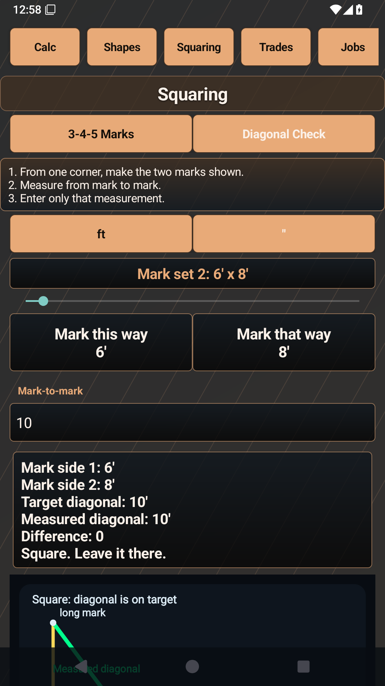
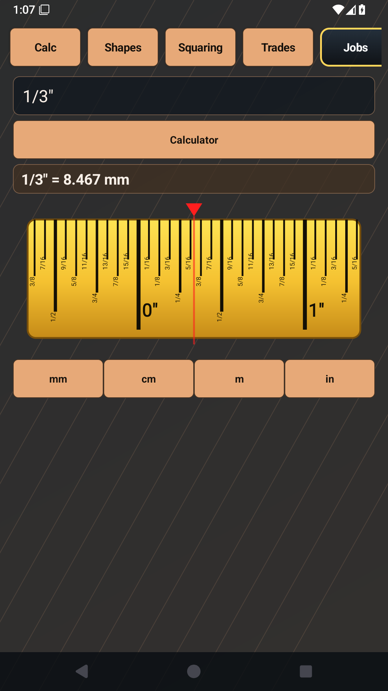
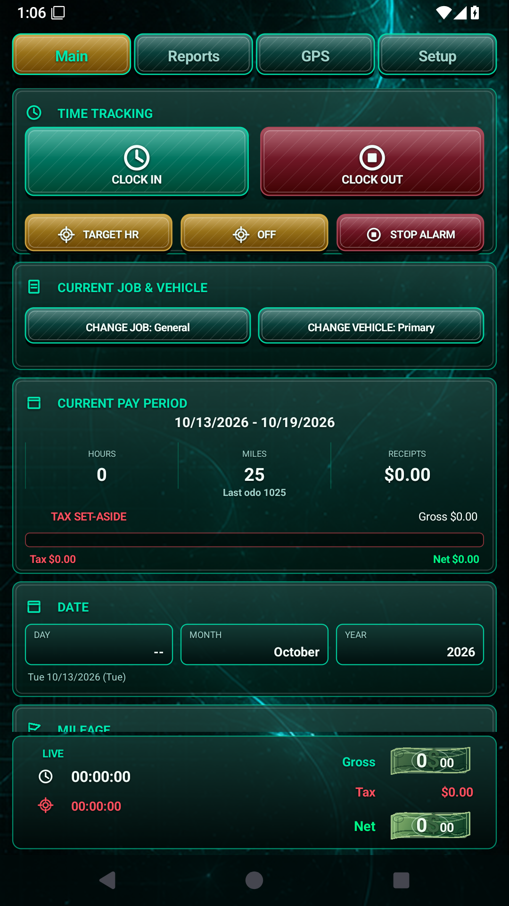
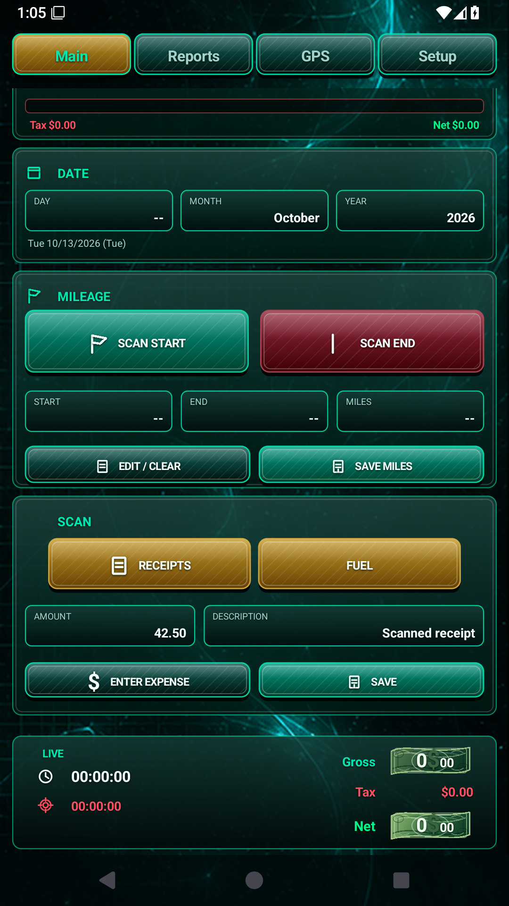

# Android app portfolio

Practical Android projects by **Joseph E Walker** ([Rahl69](https://github.com/Rahl69)), developed with AI assistance. These projects bring together trade experience, product requirements, hands-on troubleshooting and functional verification.

This portfolio contains demonstrations and testing evidence. **Both applications' source repositories are private** and are not available to public reviewers through this page. The technology stacks below describe the projects, not a claim of independent mastery of every language or library.

## CalcWorx

**Problem:** construction work often requires converting fractional measurements, checking a square layout and turning dimensions into material quantities without losing track of units.

**Status:** maintained development project, version 2.3.3 (26), tested locally in this audit. Public store availability has not been verified.

Verified examples include fractional inch/mm conversion, scaled 3-4-5 squaring, exact tape positioning alongside rounded measurements, concrete bag estimates and board-foot quantities. Workflow tests also exercised saving estimates, changing prices and avoiding duplicate items on repeated saves.

The product keeps exact measurement values separate from rounded tape marks, supports useful field-sized squaring multiples, and groups calculations by trade. The maintained build combines Java integration helpers with reconstructed smali/resources and Android tooling; it is not presented as an original full Java/Kotlin source project.

 

These are real emulator captures. The rounded 8.467 mm display does not replace the exact measurement used by the tape. The squaring page continues below the viewport.

**Technical challenge:** making the maintained reconstructed project build without an owner's signing keys. The audit added and tested a separate development build path, preserving the app identity and original files. Broader graphics, screen-size and accessibility verification remains outstanding.

## Titan1099

**Problem:** independent workers need a practical way to retain mileage, work and receipt records and reopen them for review and reporting.

**Status:** maintained development/testing project, version 4.5.43 (101). Debug assembly and bounded emulator checks passed; Android lint still reports 25 errors and 212 warnings. Public release availability has not been established by this audit.

Verified examples include odometer-based mileage, saved mileage surviving relaunch, invalid-date and mileage rejection, CSV escaping, synthetic receipt OCR, fuel-record calculations, PDF creation and backup/restore checks. The app uses local records and keeps manual entry alongside scanning. GPS and building-related features require further physical testing.

**Project stack:** Java, Android views and a custom-drawn main interface, Gradle, local CSV/JSON files and preferences, AndroidX, ML Kit OCR and a WebView map interface. Earlier app-specific classes were reconstructed and repaired; development used AI assistance.

 

**Technical challenge:** an old audit assumed building tracking was enabled. Investigation identified the changed feature default, and updating the fixture restored the intended test. The app was not changed to make the test pass. The main custom-drawn interface exposes limited automation text, so accessibility remains a known area for improvement.

## Evidence and scope

Read the [testing evidence](TESTING.md) for sample inputs, independent expected results, actual outcomes and unresolved issues. The audit and new regression tests were produced with AI assistance on **October 13, 2026**. They are distinguished from pre-existing tests and historical work.

This repository publishes documentation and synthetic-data screenshots only. It contains no application source, installers, signing files, personal records or private testing links. These are recordkeeping and estimation tools; no certification or guaranteed professional result is claimed.

Repeatability note: CalcWorx's older theme tests failed on a later rerun after its 3D recovery state was set. See the testing report for the initial passes and subsequent failures.

Titan's broad audit also timed out on a later isolated recheck. This unresolved repeatability finding is included in the testing report.
